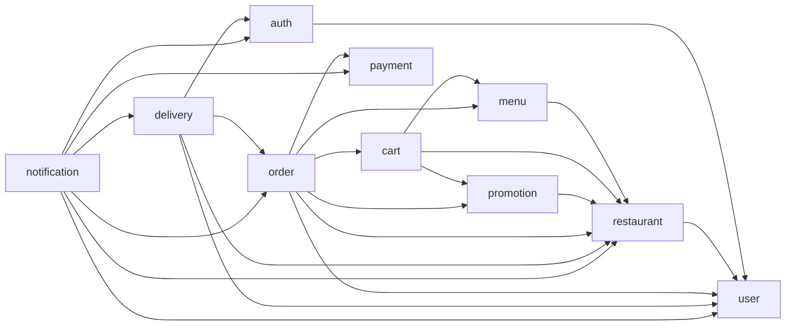
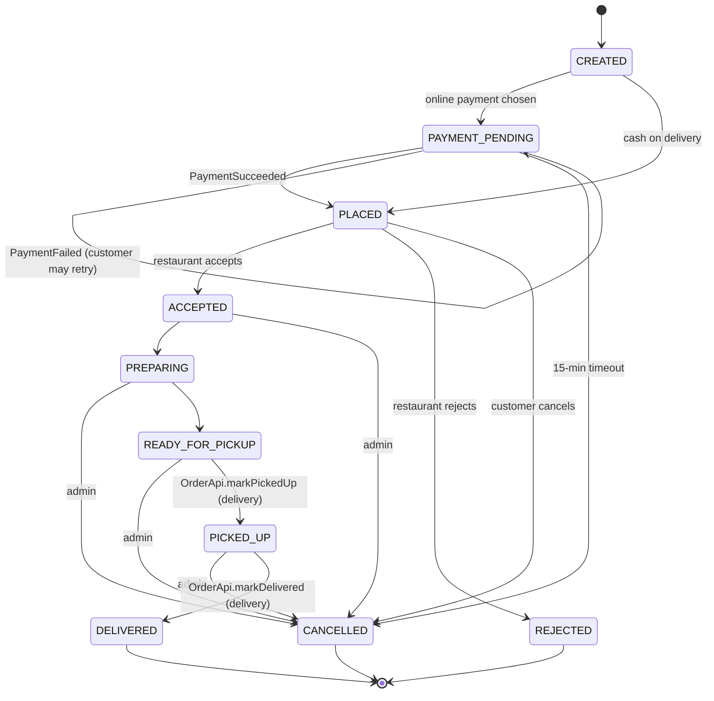
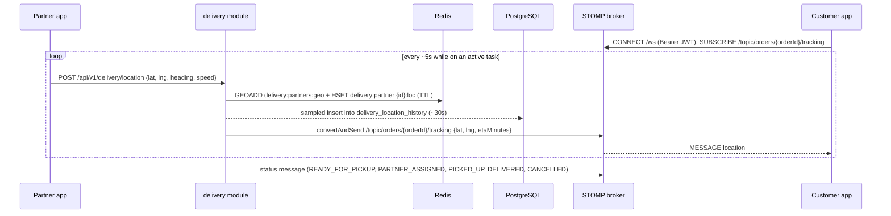
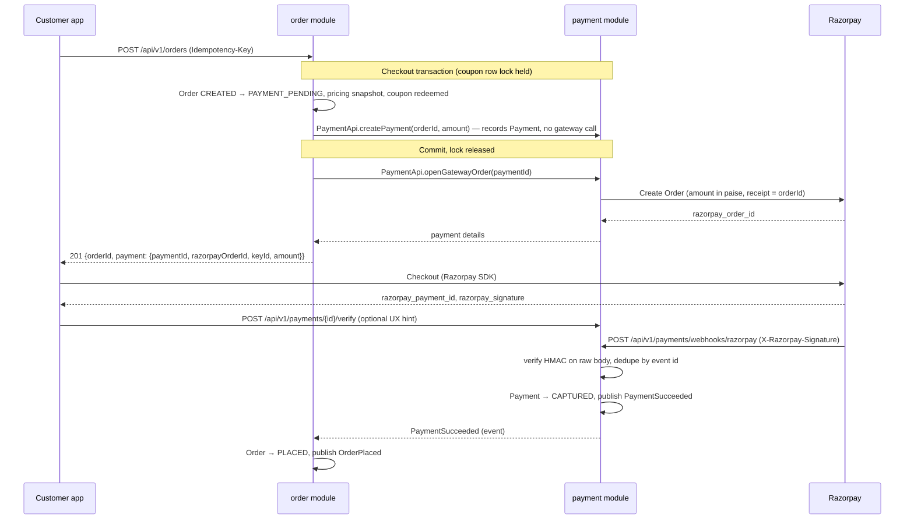

# Architecture — vsnvi-food

## 1. Overview

vsnvi-food is a food-delivery backend (Zomato/Swiggy style), built as a **modular monolith**:
one Spring Boot deployable and one PostgreSQL database, split internally into business modules
with strict boundaries. [ADR-001](decisions/ADR-001-modular-monolith.md) explains why.

| Concern        | Choice                                                               |
|----------------|----------------------------------------------------------------------|
| Runtime        | Java 25, Spring Boot 4.1                                             |
| Build          | Maven (wrapper)                                                      |
| Persistence    | PostgreSQL, Spring Data JPA, Flyway migrations                       |
| Cache / geo    | Redis (GEO index, latest locations, pub/sub fan-out)                 |
| Real-time      | WebSocket with STOMP (Spring messaging)                              |
| Security       | Spring Security, stateless JWT via jjwt ([ADR-002](decisions/ADR-002-jwt-with-jjwt.md)) |
| Payments       | Razorpay (behind a `PaymentGateway` interface)                       |
| Modules/events | Spring Modulith 2.x: boundary verification, Event Publication Registry (JPA) ([ADR-003](decisions/ADR-003-spring-modulith.md)) |
| Notifications  | Spring Mail (email); push/SMS later                                  |
| Observability  | Spring Boot Actuator                                                 |
| API docs       | springdoc-openapi 3.x (OpenAPI 3 + Swagger UI), generated from code |
| Testing        | JUnit 5, AssertJ, Testcontainers (PostgreSQL, Redis)                 |

The base package is `com.vsnvi.vsnvi_food`, and each module is a top-level sub-package of it
(for example `com.vsnvi.vsnvi_food.order`).

Related docs:
- [API-DESIGN.md](API-DESIGN.md)
- [DATABASE-DESIGN.md](DATABASE-DESIGN.md)
- [SECURITY.md](SECURITY.md)
- [PROGRESS.md](PROGRESS.md)

## 2. Modules

| Module         | Responsibility                                                              | Key entities                                              |
|----------------|-----------------------------------------------------------------------------|-----------------------------------------------------------|
| `auth`         | Credentials, login, JWT issue/refresh/revoke, password hashing              | `Credential`, `RefreshToken`                              |
| `user`         | User profile, role, addresses, account status (active/blocked)              | `User`, `Address`                                         |
| `restaurant`   | Restaurant onboarding and approval, opening hours, location, serviceable radius | `Restaurant`, `OpeningHours`                          |
| `menu`         | Menu categories, items, variants, add-ons, availability                     | `MenuCategory`, `MenuItem`, `Variant`, `AddOn`            |
| `cart`         | One active cart per customer, with items from a single restaurant only      | `Cart`, `CartItem`                                        |
| `order`        | Checkout, pricing snapshot, order state machine                             | `Order`, `OrderItem`, `OrderStatusHistory`                |
| `payment`      | Razorpay orders, webhooks, refunds, cash-on-delivery records                | `Payment`, `Refund`, `ProcessedWebhook`                   |
| `delivery`     | Partner availability, assignment, delivery tasks, live tracking             | `DeliveryPartner`, `DeliveryTask`, `LocationHistory`      |
| `promotion`    | Coupons (platform and restaurant), evaluation, redemption limits            | `Coupon`, `CouponRedemption`                              |
| `notification` | Email (later push/SMS) and WebSocket pushes; reacts to events only          | `NotificationLog`                                         |
| `common`       | Shared kernel: `Money`, `BaseEntity`, error model, pagination, idempotency, current-user access, STOMP configuration and its SPIs. **No business logic.** Open module. | `IdempotencyRecord` |

Roles are `CUSTOMER`, `RESTAURANT_OWNER`, `RIDER` and `ADMIN`.
[SECURITY.md](SECURITY.md) covers them in detail.

### Package layout per module

```
<module>/
├── api/              PUBLIC: facade interface <Module>Api, facade DTO records, published events
│   └── web/          REST controllers + request/response records (internal)
├── application/      use cases, @Transactional, <Module>Api implementation,
│                     event publishing, @ApplicationModuleListener listeners, scheduled jobs
├── domain/           entities, value objects, enums, module exceptions, repository interfaces
└── infrastructure/   Spring Data JPA / Redis implementations, external clients
                      (e.g. Razorpay), mappers, @Configuration
```

**Public surface of a module.** Other modules may use only the classes directly in `api/`: the
`<Module>Api` facade, its DTO records and the module's event records. Everything else is internal,
including `api/web/`.

**`common` layout.** `common` is a shared kernel with no facade, no endpoints and no business logic,
so it uses its own sub-packages instead of the module layout above. Every module may use all of
them.

```
common/
├── domain/   BaseEntity, Money, DomainException, ErrorCode, NotFoundException
├── web/      GlobalExceptionHandler, ProblemDetailFactory, PageResponse, request filters
├── security/ AuthenticatedUser, CurrentUser, TokenAuthenticator SPI, bearer-token filter (ADR-006)
├── idempotency/ IdempotencyService, IdempotencyRecord (idempotency_keys), @IdempotencyKeyHeader
├── ratelimit/ RateLimiter (Redis fixed-window counters, fails open), RateLimitedException
└── config/   cross-cutting @Configuration (Clock, JPA auditing, SecurityConfig, STOMP, OpenAPI)
```

### Boundary enforcement (Spring Modulith)

Why Modulith: [ADR-003](decisions/ADR-003-spring-modulith.md).


- **Modules:** Spring Modulith treats each direct sub-package of `com.vsnvi.vsnvi_food` as an
  application module. The module's own base package holds no classes, so by default every
  sub-package is **internal**.
- **Named interface:** `api/package-info.java` declares `@NamedInterface("api")`, which makes
  `api` the only package other modules may use.
  - `api.web` must stay internal. When the verify test is first added, check in the
    `ApplicationModules` output that `api.web` isn't listed as part of the `api` named interface.
- **`common`:** a shared, open module, declared with
  `@ApplicationModule(type = ApplicationModule.Type.OPEN)` in `common/package-info.java`.
  Every module may use it.
- **Verification:** a test runs
  `ApplicationModules.of(VsnviFoodApplication.class).verify()`. It fails the build on:
  - access to another module's internal types;
  - **dependency cycles between modules**.
- **What counts as a dependency:** for Modulith, a dependency is any type reference. Listening to
  another module's event is a dependency on that module, exactly like calling its facade. This is
  why §3 says events flow *up* the graph and calls go *down*.
- **Module documentation:** `Documenter` can generate module diagrams (PlantUML/C4) from the
  verified model, as an optional CI step.

The binding rules are in [`.claude/rules/java.md`](../.claude/rules/java.md).

### Dependency direction



Every arrow means "depends on". The dependent module may call the target's `<Module>Api` and/or
listen to the target's events. The graph is **acyclic**, and `ApplicationModules.verify()`
enforces that. Every module may depend on `common`, and `common` depends on nothing.

What each key dependency is used for:

| Dependency            | Calls (sync, via `<Module>Api`)                                   | Listens to (events)                                  |
|-----------------------|-------------------------------------------------------------------|------------------------------------------------------|
| `auth → user`         | `createUser` at registration, role and status lookup at login      | `UserBlocked` (revoke refresh tokens, close STOMP sessions) |
| `cart → promotion`    | `evaluate` a coupon for the price preview                          | —                                                    |
| `order → cart`        | price the cart; `clear` it at checkout (same transaction)          | —                                                    |
| `order → promotion`   | `redeem` at checkout; `release` on reject/cancel/timeout           | —                                                    |
| `promotion → restaurant` | ownership check for restaurant coupons                          | —                                                    |
| `order → payment`     | `createPayment` inside the checkout transaction, then `openGatewayOrder` after commit; on reject/cancel/timeout `cancelPayment` (refunds if captured, voids otherwise); `markCollected` (COD) | `PaymentSucceeded`, `PaymentFailed`, `RefundIssued` |
| `delivery → auth`     | —                                                                 | `UserRegistered` (role `RIDER`: create a `PENDING_APPROVAL` partner profile) |
| `delivery → order`    | `markPartnerAssigned`, `markPickedUp`, `markDelivered`; ownership and location reads | `OrderReadyForPickup` (start assignment), `OrderCancelled` (cancel task) |
| `notification → *`    | contact details (`UserApi`), order and restaurant summaries        | all customer-facing events                           |

## 3. Module communication rules

1. **Synchronous calls go only through the target module's `<Module>Api` facade.** They are
   allowed for:
   - reads, e.g. `MenuApi.getItemsForPricing(...)`;
   - commands whose result the caller needs right away, inside the same request, e.g.
     `PaymentApi.createPayment(...)` at checkout or `UserApi.createUser(...)` at registration.
2. **Calls go down the graph, events go up.**
   - A module may call, and listen to the events of, only the modules it depends on.
   - To make a module it depends on act, call that module's facade. For example, `order` calls
     `PaymentApi.cancelPayment(...)` when an order is rejected.
   - To tell modules that depend on it that something happened, publish an event and let them
     react. For example, `delivery` listens for `OrderReadyForPickup`.
   - A module never listens to the events of a module that depends on it.
3. **A module never touches another module's entities, repositories or tables.**
   - No cross-module JPA relationships, SQL joins or foreign keys.
   - Refer to another module's aggregate by its ID only.
4. **No cycles between modules.** Both a call and an event listener create a dependency, so
   swapping one for the other doesn't break a cycle. Restructure the flow instead.
5. **Boundaries are enforced by Spring Modulith** (`ApplicationModules.verify()` in a test).
   See [§2 Boundary enforcement](#boundary-enforcement-spring-modulith).

## 4. Events

### Mechanism

- **Publishing:** services publish with `ApplicationEventPublisher`, inside the business
  transaction.
- **Event Publication Registry (Spring Modulith, JPA):** this replaces a hand-written outbox.
  - When an event is published, Modulith records one entry per listener in the
    `event_publication` table, in the same transaction.
  - An entry is marked completed when its listener succeeds. Failed entries stay incomplete.
  - Incomplete entries are resubmitted on restart
    (`spring.modulith.events.republish-outstanding-events-on-restart=true`) and by a scheduled
    job using `IncompleteEventPublications`.
  - Completed entries are cleaned up by the configured completion mode.
- **Consuming:** consumers use `@ApplicationModuleListener`. It runs after commit, asynchronously,
  in its own transaction, so it sees committed state only. This needs `@EnableAsync`.
- **Event shape:** events are immutable records with past-tense names. They carry IDs, the minimal
  data consumers need, and `occurredAt`. They never carry entities.
- **Idempotent consumers:** delivery is at least once, so every consumer must be idempotent.
- **Moving to a broker later:** events marked `@Externalized` can be published to Kafka or
  RabbitMQ through Modulith's event externalization, without changing publishers.

### Event catalog

| Event                 | Publisher | Consumers                          | Payload (key fields)                         |
|-----------------------|-----------|------------------------------------|----------------------------------------------|
| `UserRegistered`      | auth      | delivery (create partner profile), notification | userId, email, role           |
| `UserBlocked`         | user      | auth (revoke refresh tokens)       | userId, reason                               |
| `OrderPlaced`         | order     | notification (incl. restaurant WS) | orderId, restaurantId, customerId, total     |
| `PaymentSucceeded`    | payment   | order, notification                | paymentId, orderId, amount, gatewayPaymentId |
| `PaymentFailed`       | payment   | order (no state change), notification | paymentId, orderId, reason                |
| `OrderAccepted`       | order     | notification                       | orderId, restaurantId, prepTimeMinutes       |
| `OrderRejected`       | order     | notification                       | orderId, reason                              |
| `OrderReadyForPickup` | order     | delivery (start assignment), notification | orderId, restaurantId, customerId, dropOffLat, dropOffLng (from the order's address snapshot) |
| `DeliveryAssigned`    | delivery  | notification                       | orderId, deliveryTaskId, partnerId           |
| `DeliveryAssignmentStalled` | delivery | notification (alert admins) | orderId, deliveryTaskId, waitingSince     |
| `OrderPickedUp`       | order     | notification                       | orderId, partnerId, pickedUpAt               |
| `OrderDelivered`      | order     | notification                       | orderId, partnerId, deliveredAt              |
| `OrderCancelled`      | order     | delivery (cancel task), notification | orderId, cancelledBy, reason               |
| `RefundIssued`        | payment   | order, notification                | refundId, orderId, amount                    |

Some effects are **calls, not events**, because the event would point the wrong way in the graph:
- Refunds and voids on reject, cancel or payment timeout: `order` calls `PaymentApi.cancelPayment`.
- Cash-on-delivery collection: `order` calls `PaymentApi.markCollected`.
- Clearing the cart: `order` calls `CartApi.clear` at checkout.
- Pickup and delivery: `delivery` calls `OrderApi.markPickedUp` and `OrderApi.markDelivered`, and
  then `order` publishes `OrderPickedUp` and `OrderDelivered`. Order events are therefore always
  published by `order`.

## 5. Order state machine



| From               | Allowed to                          | Triggered by                          |
|--------------------|-------------------------------------|---------------------------------------|
| `CREATED`          | `PAYMENT_PENDING`, `PLACED`         | checkout                              |
| `PAYMENT_PENDING`  | `PLACED` (on `PaymentSucceeded`), `CANCELLED` (15-minute timeout only) | payment events, timeout job |
| `PLACED`           | `ACCEPTED`, `REJECTED`, `CANCELLED` | restaurant owner, customer            |
| `ACCEPTED`         | `PREPARING`, `CANCELLED` (admin)    | restaurant owner, admin               |
| `PREPARING`        | `READY_FOR_PICKUP`, `CANCELLED` (admin) | restaurant owner, admin           |
| `READY_FOR_PICKUP` | `PICKED_UP`, `CANCELLED` (admin)    | delivery partner via `OrderApi.markPickedUp`, admin |
| `PICKED_UP`        | `DELIVERED`, `CANCELLED` (admin)    | delivery partner via `OrderApi.markDelivered`, admin |

`DELIVERED`, `REJECTED` and `CANCELLED` are terminal.

**Who can cancel:**
- A customer, only while the order is `PLACED`.
- An `ADMIN`, from any non-terminal state after checkout.
- The timeout job, from `PAYMENT_PENDING`.

Every cancellation calls `PaymentApi.cancelPayment` (refund if captured, void otherwise) and
`PromotionApi.release` (gives the coupon use back), then publishes `OrderCancelled`. Rejection
does the same and publishes `OrderRejected`. `delivery` then cancels any active task, frees the partner and pushes a
`CANCELLED` status to the tracking topic. In v1 an admin cancellation after pickup is fully refunded.

**A failed payment doesn't cancel the order.** `PaymentFailed` leaves the order in
`PAYMENT_PENDING` and notifies the customer. The customer can retry within the same Razorpay
order, or use `POST /payments/{id}/retry`. Only the 15-minute timeout cancels an unpaid order.

- **Enforcement:** transitions are enforced inside the `Order` aggregate through intention-revealing
  methods such as `order.accept(prepTime)` and `order.markPickedUp()`.
- **Illegal transitions:** these throw `InvalidOrderStateException`, which maps to HTTP 409 with
  code `INVALID_ORDER_STATE`.
- **History:** every transition appends a row to `order_status_history`.
- **Concurrency:** `Order` uses optimistic locking (`@Version`). Event listeners must tolerate
  a duplicate or late event, for example a `PaymentSucceeded` that arrives after a timeout
  cancellation. In that case the `order` listener **ignores** the event (the order is no longer
  `PAYMENT_PENDING`). Refunding that late capture is owned by `payment` alone (see
  [§7 Refunds](#7-payment-flow-razorpay)), so a payment is never refunded twice.
- **Pricing snapshot:** the order stores item names, unit prices, add-ons, the packaging charge,
  the delivery fee, the coupon code and discount, and the tax, exactly as calculated in
  [§8](#8-pricing-and-coupons). Later menu, fee or coupon changes never affect past orders.
- **Address snapshot:** at checkout the order also copies the drop-off address (text and
  `lat`/`lng`) from `UserApi`. Editing or deleting the address later doesn't affect the order or
  its delivery.
- **Assigned partner:** `OrderApi.markPartnerAssigned(orderId, partnerUserId)` doesn't change the
  status (the order stays `READY_FOR_PICKUP`). It stores the partner's **user ID** on the order,
  which `order` uses to let that partner read the order (`GET /orders/{id}`) and which goes into
  `OrderPickedUp` and `OrderDelivered`.

## 6. Real-time tracking (Redis GEO + WebSocket STOMP)

Why this design: [ADR-004](decisions/ADR-004-real-time-tracking.md).



- **Ingestion:**
  - Partners send `POST /api/v1/delivery/location` about every 5 seconds while online.
  - Each ping is validated: the caller must be a partner, coordinates must be within sane bounds,
    and pings are rate-limited.
  - Sending location over STOMP (`SEND /app/delivery/location`) is an optional later optimisation.
- **Redis GEO:**
  - `delivery:partners:geo` is a GEO set holding **online, available** partners.
  - A partner is removed when they go offline, accept a task, or their heartbeat expires.
    GEO members can't have their own TTL, so a scheduled sweeper in `delivery` (every ~30s)
    removes every member whose `delivery:partner:{partnerId}:loc` key has expired.
  - `delivery:partner:{partnerId}:loc` is a hash with the latest `lat`, `lng`, `heading`, `speed`
    and `ts`, with a TTL of about 60 seconds.
- **Assignment:**
  - Assignment starts when `delivery` receives `OrderReadyForPickup`. The event carries the
    restaurant, the customer and the drop-off coordinates (from the order's address snapshot),
    so `delivery` can check ownership and compute ETAs later without extra calls.
  - Trade-off: the food waits for the partner. To shorten that wait later, assignment can start
    earlier using `prepTimeMinutes`, without changing the module graph.
  - `GEOSEARCH delivery:partners:geo FROMLONLAT <restaurant> BYRADIUS <r> km ASC COUNT n` returns
    the nearest available partners.
  - The task is offered to the nearest partner. If they don't accept before the timeout, it goes to
    the next one.
  - If no partner is found, the radius widens up to a configured maximum
    (`delivery.assignment.max-radius-km`).
  - If no partner has accepted within `delivery.assignment.alert-after` (default 15 minutes),
    `delivery` publishes `DeliveryAssignmentStalled`. `notification` alerts the admins, who decide
    whether to keep waiting or cancel the order. Assignment keeps retrying until then.
  - Only **approved** partners can go online, so only they appear in the GEO set.
  - A short Redis lock per partner prevents double offers.
  - Once a partner accepts, `delivery` calls `OrderApi.markPartnerAssigned` and publishes
    `DeliveryAssigned`.
  - A partner has at most one active task at a time (no batching in v1).
- **Delivery OTP:**
  - `delivery` generates a random 4-digit OTP (`SecureRandom`) when the task is created and
    stores it on the task. It isn't hashed: the customer must be able to see it, and hashing a
    4-digit value adds no real protection.
  - The customer sees the OTP in `GET /api/v1/orders/{id}/tracking`. It is never returned to the
    partner and never logged.
  - The partner submits it to `POST /delivery-tasks/{id}/deliver`, compared in constant time.
    Attempts are limited to 5 per task; after that an admin must step in. This limit is what
    protects the OTP.
  - The OTP is cleared when the task ends (delivered or cancelled).
- **History:**
  - Pings are sampled into `delivery_location_history` (about one row every 30 seconds per task),
    for disputes and analytics.
  - Redis is never the system of record.
- **Fan-out (STOMP):**
  - STOMP endpoint: `/ws`. Application destination prefix: `/app`.
  - Customers subscribe to `/topic/orders/{orderId}/tracking` for `location`, `status` and `eta`
    messages.
  - **Only `delivery` publishes to the tracking topic**, and it starts when it receives
    `OrderReadyForPickup`. It sends:
    - `status` messages for `READY_FOR_PICKUP` (finding a partner), `PARTNER_ASSIGNED`,
      `PICKED_UP`, `DELIVERED` and `CANCELLED` (on `OrderCancelled`);
    - `location` and `eta` messages once a partner is assigned.
  - **No live status pushes before READY_FOR_PICKUP.** For earlier statuses (`PLACED`,
    `ACCEPTED`, `PREPARING`), the customer app polls `GET /api/v1/orders/{id}`. Email
    notifications are unaffected.
  - Restaurant dashboards subscribe to `/topic/restaurants/{restaurantId}/orders` for new and
    updated orders.
  - Partners subscribe to `/user/queue/offers` for task offers.
- **Security:** the JWT is validated on STOMP `CONNECT`, and every `SUBSCRIBE` is authorized by
  ownership in a `ChannelInterceptor`. See [SECURITY.md](SECURITY.md#5-websocket-stomp).
- **Where the WebSocket code lives:** `common` owns the STOMP plumbing and defines interfaces
  (SPIs) that business modules implement. `common` never depends on a business module; Spring
  injects the implementations.

  | Piece (in `common`)          | What it does                                                    | Implemented / used by |
  |------------------------------|-----------------------------------------------------------------|-----------------------|
  | STOMP config + `ChannelInterceptor` | Endpoint `/ws`, broker prefixes, intercepts `CONNECT` and `SUBSCRIBE` | — |
  | `TokenAuthenticator` (SPI)   | Turns the `CONNECT` bearer token into a principal (user ID, role, token `exp`) | `auth`, using `JwtService` |
  | `SubscriptionAuthorizer` (SPI) | Decides whether a principal may subscribe to a destination  | `delivery` (`/topic/orders/*/tracking`), `notification` (`/topic/restaurants/*/orders`) |
  | `StompSessionRegistry`       | Tracks open sessions per user with their token `exp`; a scheduled sweep closes expired ones | `auth` calls `closeSessionsOf(userId)` when it receives `UserBlocked` |
- **Scaling:**
  - A single instance uses the in-memory simple broker.
  - Multiple instances relay messages between nodes over Redis pub/sub, or move to a STOMP broker
    relay (RabbitMQ).
  - Publishers code against a `TrackingPublisher` interface, so swapping the transport doesn't
    affect callers.
- **ETA:** the first version divides haversine distance by an average speed. It sits behind an
  `EtaCalculator` interface so a maps provider can be plugged in later.

## 7. Payment flow (Razorpay)



- **No gateway call under a lock:** the checkout transaction holds the coupon row lock, so it
  only records the `Payment`. The Razorpay order is created by `PaymentApi.openGatewayOrder`
  after commit, in its own short transaction. If that call fails, the order stays
  `PAYMENT_PENDING`, checkout still returns `201` with the `paymentId` and no `razorpayOrderId`,
  and the client calls `POST /payments/{id}/retry`. An order the customer never pays is cancelled
  by the 15-minute timeout as usual.
- **Gateway abstraction:**
  - The `PaymentGateway` interface has `createOrder`, `verifyCheckoutSignature`, `verifyWebhook`
    and `refund`.
  - `RazorpayGateway` is the real implementation.
  - `FakePaymentGateway` is used locally and in tests.
- **Checkout signature (client callback):**
  - The client sends back a signature computed as
    `HMAC_SHA256(razorpay_order_id + "|" + razorpay_payment_id, key_secret)`.
  - The server verifies it with a constant-time comparison.
  - **This only updates the UX ("payment processing").** It never moves the order to `PLACED`.
- **Webhook (source of truth):**
  - `X-Razorpay-Signature` is `HMAC_SHA256(rawRequestBody, webhook_secret)`. Verify it against
    the **raw bytes** before parsing JSON, with a constant-time comparison.
  - If the signature is invalid, return `400` and process nothing.
  - Events handled: `payment.captured`, `payment.failed`, `refund.processed` and `refund.failed`.
  - Before acting, re-check that the amount, currency and `razorpay_order_id` match the stored
    `Payment`.
- **Idempotent webhooks:**
  - Insert the `x-razorpay-event-id` header value into `processed_webhooks`, which has a unique key,
    **in the same transaction** as the payment state change. If processing fails, the insert
    rolls back too, so Razorpay's retry is processed instead of being skipped as a duplicate.
  - On a duplicate, return `200` and skip processing.
  - Payment status changes are monotonic (e.g. `CAPTURED` is never downgraded).
  - Respond `2xx` quickly. Heavy work happens in event consumers after commit.
- **Client idempotency:**
  - `Idempotency-Key` is required on `POST /orders` and `POST /payments/{id}/retry`.
  - The format is described in [API-DESIGN.md](API-DESIGN.md#6-idempotency).
- **Timeout:** a scheduled job in `order` cancels orders that have been in `PAYMENT_PENDING` for more than
  15 minutes, calls `PaymentApi.cancelPayment` (which voids the unpaid payment), and publishes
  `OrderCancelled`.
- **Refunds:**
  - When an order is rejected or cancelled, `order` calls `PaymentApi.cancelPayment`.
    - If the payment was captured, `payment` calls the Razorpay refund API and records a `Refund`.
    - Otherwise (not yet captured, or cash on delivery), the payment is marked `VOIDED`.
  - A payment captured after it was voided (a late webhook) is refunded automatically by
    `payment`, which doesn't publish `PaymentSucceeded` for it. This is the only place a late
    capture is refunded; `order` ignores late payment events.
  - If the capture is recorded first and the order is cancelled afterwards, `cancelPayment` sees
    `CAPTURED` and refunds it. Either way, exactly one refund happens.
  - Refund webhooks update the refund status and publish `RefundIssued`.
- **Cash on delivery:**
  - There is no gateway call. The order goes straight from `CREATED` to `PLACED`.
  - The `Payment` is recorded as `PENDING_COLLECTION` and becomes `COLLECTED` when `order` calls
    `PaymentApi.markCollected` on delivery.
- **Money:**
  - Stored as `NUMERIC(12,2)` plus an ISO currency code, never floating point.
  - Amounts sent to Razorpay are integers in minor units (paise).

## 8. Pricing and coupons

Why this design: [ADR-005](decisions/ADR-005-pricing-and-promotion.md).

### Price breakdown

There is a single price calculator, `CartPricing` in `cart`. The cart page shows its result, and
checkout snapshots that same result, so the two never disagree. The one exception is the coupon
discount amount: `promotion` calculates it (`evaluate` for the preview, `redeem` at checkout), and
`CartPricing` only uses that amount. No other code calculates prices, tax or discounts.

| Line                | Source                                                                  |
|---------------------|-------------------------------------------------------------------------|
| Item subtotal       | Item, variant and add-on prices from `MenuApi`: unit price = the chosen variant's price (it **replaces** the base price; an item with variants needs one) + the add-on prices, × quantity |
| Packaging charge    | Flat per-order amount set by the restaurant (`RestaurantApi`)           |
| Delivery fee        | Flat per-order amount set by the restaurant (`RestaurantApi`)           |
| Discount            | From at most **one** coupon, evaluated by `PromotionApi`                |
| Tax (GST)           | `pricing.tax-percent` (config) × (item subtotal − item discount + packaging charge). The delivery fee is not taxed in v1 |
| **Total**           | subtotal + packaging + delivery fee − discount + tax, never below 0      |

- **Rounding:** all amounts are `Money`, rounded half-up to 2 decimals at each line.
- **Restaurant fees:** owners set `deliveryFee` and `packagingCharge` with
  `PATCH /restaurants/{id}`. Both default to 0.

### Coupons (`promotion` module)

- **Who creates them:**
  - Admins create **platform** coupons, valid at any restaurant.
  - Restaurant owners create **restaurant** coupons, valid only at their own restaurants.
- **Discount types:**
  - `FLAT`: a fixed amount off the item subtotal, e.g. ₹100.
  - `PERCENT`: a percentage of the item subtotal, with a required `maxDiscount` cap.
  - `FREE_DELIVERY`: waives the delivery fee.
  - A `FLAT` or `PERCENT` discount never exceeds the item subtotal.
- **Rules,** all enforced in v1:
  - A validity window (`validFrom` and `validUntil`) and an `active` flag.
  - A minimum item subtotal (`minOrderSubtotal`).
  - `perCustomerLimit` and `totalLimit`.
  - `firstOrderOnly`: the customer has no previous order that reached `PLACED` and wasn't cancelled
    or rejected.
  - A restaurant coupon only applies when the cart is from that restaurant.
- **Flow:**
  1. The customer applies a code to the cart (`POST /cart/coupon`). `cart` stores the code and
     calls `PromotionApi.evaluate` to show the discount. This is a **preview** and reserves nothing.
  2. At checkout, inside the order transaction, `order`:
     - prices the cart through `CartApi`;
     - calls `PromotionApi.redeem(code, customerId, orderId, pricingContext, isFirstOrder)`. This
       locks the coupon row, re-checks every rule, records a `CouponRedemption` and returns the
       final discount.
     If the result differs from the preview, checkout fails with `422`, and the client re-reads
     the cart.
  3. On rejection, cancellation (including the payment timeout), `order` calls
     `PromotionApi.release(orderId)`. The redemption is marked `RELEASED`, so the customer gets the
     use back and the total count drops.
- **First-order check:** `order` passes `isFirstOrder`, because only `order` knows the customer's
  order history and `promotion` can't depend on `order`. The cart preview can't know this, so it
  marks such coupons as "first order only". Checkout is authoritative.
- **Concurrency:** `totalLimit` and `perCustomerLimit` are enforced with a row lock
  (`SELECT … FOR UPDATE`) on the coupon inside the order transaction, so two checkouts can't both
  take the last use.
- **Funding and settlement** of discounts between the platform and restaurants are out of scope
  for v1.

## 9. Cross-cutting concerns

- **Security:** stateless JWT, role checks and ownership checks. See [SECURITY.md](SECURITY.md).
- **API documentation:** the OpenAPI spec is generated by springdoc from the controllers.
  There is one group per module, and Swagger UI is enabled outside prod only.
  See [API-DESIGN.md](API-DESIGN.md#11-openapi-and-swagger-ui).
- **Errors:** a single `@RestControllerAdvice` returns RFC 9457 `ProblemDetail`.
  See [API-DESIGN.md](API-DESIGN.md#4-error-format).
- **Database:**
  - One schema, and each table is owned by exactly one module.
  - Flyway is the source of truth for the schema.
  - See [DATABASE-DESIGN.md](DATABASE-DESIGN.md).
- **Observability:**
  - Actuator health, metrics and info endpoints.
  - A `traceId` in MDC, which is also returned in error responses.
  - Structured logs.
- **Time:** all timestamps are stored and returned in UTC (`Instant` and `timestamptz`).
- **Testing:** see [`.claude/rules/testing.md`](../.claude/rules/testing.md).

## 10. Working agreements

- **Branches:** `feature/<module>-<short-desc>`, `fix/<short-desc>` and `chore/<short-desc>`.
- **Commits:** follow Conventional Commits, e.g. `feat(order): add cancel endpoint`.
- **PRs:** keep them small, one module or concern per PR. `./mvnw verify` must pass.
- **Progress:** tick items in [PROGRESS.md](PROGRESS.md) once they are merged.
- **ADRs:** record every significant architectural decision as an ADR in [decisions/](decisions/).

## 11. Future evolution

Extract a module into a separate service only when one of the criteria in ADR-001 is met.
The likely order is:

1. **delivery/tracking:** high write volume from location pings, and it needs to scale on its own.
2. **notification:** it is already purely event-driven.
3. **payment:** to isolate PCI scope, if that becomes necessary.

Before any extraction:

- Externalize the module's events to a real message broker (`@Externalized`).
- Move STOMP fan-out to a broker relay or Redis pub/sub.
