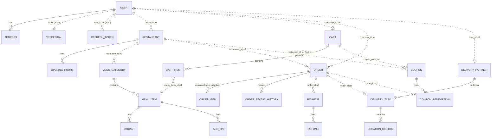

# Database Design — vsnvi-food

> **Flyway migrations in `src/main/resources/db/migration` are the source of truth for the schema.**
> This document is only a high-level map of entities and relationships. It doesn't list columns,
> types or indexes. If this doc and a migration disagree, the migration wins, so update this doc.

## 1. Principles

- **One database, one schema, one owner per table.** Every table belongs to exactly one module, so
  a module can later move to its own database.
- **No cross-module foreign keys.** Cross-module references are plain `UUID` columns with no
  constraint and no JPA relationship. See [ARCHITECTURE.md](ARCHITECTURE.md#3-module-communication-rules).
- **The schema is never generated.** Hibernate only validates it (`ddl-auto=validate`); every
  change is a Flyway migration.
- **Exact money and UTC time.** Money is stored as an exact decimal with a currency; timestamps
  are `timestamptz` in UTC.
- **Optimistic locking only where it's needed:** `orders`, `payments`, `carts` and
  `delivery_tasks`, the rows that are updated concurrently.

## 2. Migrations

The concrete conventions (file naming, immutability, per-module scope, column types, indexes) are
enforced by [`.claude/rules/persistence.md`](../.claude/rules/persistence.md). One special case:
Spring Modulith's `event_publication` table is created by our own migration, copied from the
schema of the Modulith version in use, because Hibernate never creates tables.

## 3. Entities by module

| Module         | Entities (tables)                                                                |
|----------------|----------------------------------------------------------------------------------|
| `auth`         | `Credential` (credentials), `RefreshToken` (refresh_tokens)                      |
| `user`         | `User` (users), `Address` (addresses)                                            |
| `restaurant`   | `Restaurant` (restaurants), `OpeningHours` (opening_hours)                       |
| `menu`         | `MenuCategory`, `MenuItem`, `Variant`, `AddOn` (menu_categories, menu_items, item_variants, item_add_ons) |
| `cart`         | `Cart` (carts), `CartItem` (cart_items)                                          |
| `order`        | `Order` (orders), `OrderItem` (order_items), `OrderStatusHistory` (order_status_history) |
| `payment`      | `Payment` (payments), `Refund` (refunds), `ProcessedWebhook` (processed_webhooks) |
| `delivery`     | `DeliveryPartner` (delivery_partners), `DeliveryTask` (delivery_tasks), `LocationHistory` (delivery_location_history) |
| `promotion`    | `Coupon` (coupons), `CouponRedemption` (coupon_redemptions)                      |
| `notification` | `NotificationLog` (notification_log)                                             |
| `common`       | `IdempotencyRecord` (idempotency_keys); Spring Modulith's `event_publication` table (created by our own Flyway migration, because `ddl-auto=validate`) |

The user role `RIDER` maps to the `delivery` module's `DeliveryPartner` profile
(`delivery_partners`). The different names are intentional: the role names who the user is, the
entity names the delivery-side profile.

## 4. Relationships

Solid lines are FKs within a module. Dotted lines are cross-module ID references, with no FK.

Key cardinalities:

- **Users:** a user has one role. A `RIDER` user has exactly one `DeliveryPartner` profile.
- **Carts:** a customer has at most one **active** cart, and every item in it comes from one restaurant.
- **Order items:** an order has many order items. Each one is a **snapshot** of name, price,
  variant and add-ons, and doesn't depend on the current menu rows.
- **Orders:** an order stores a snapshot of the drop-off address (including coordinates) and the
  assigned partner's user ID (set by `markPartnerAssigned`).
- **Payments:** an order has zero or more payments (retries), and at most one is `CAPTURED`.
  A payment has zero or more refunds.
- **Coupons:** a coupon has many redemptions (`REDEEMED` or `RELEASED`). An order has at most one
  redemption. A coupon with no `restaurant_id` is a platform coupon.
- **Restaurants:** a restaurant holds its own delivery fee and packaging charge. `cuisines` is a GIN-indexed `TEXT[]`; a CHECK limits it to 1–10 kebab-case values of at most 40 characters, because a GIN entry over ~2.7 KB fails the insert.
- **Delivery tasks:** an order has at most one active delivery task, and a partner has at most one
  active task (no batching in v1). A task holds its delivery OTP until the task ends.

## 5. Non-durable state (Redis)

These keys are not the system of record. Losing them must be recoverable.

| Key                                 | Type    | Purpose                                   |
|-------------------------------------|---------|-------------------------------------------|
| `delivery:partners:geo`             | GEO set | Online, available partners for `GEOSEARCH` |
| `delivery:partner:{id}:loc`         | Hash + TTL | Latest location of a partner            |
| `delivery:offer-lock:{partnerId}`   | String + TTL | Prevents double task offers            |
| `ratelimit:*`                       | String + TTL | Rate-limit counters                    |
